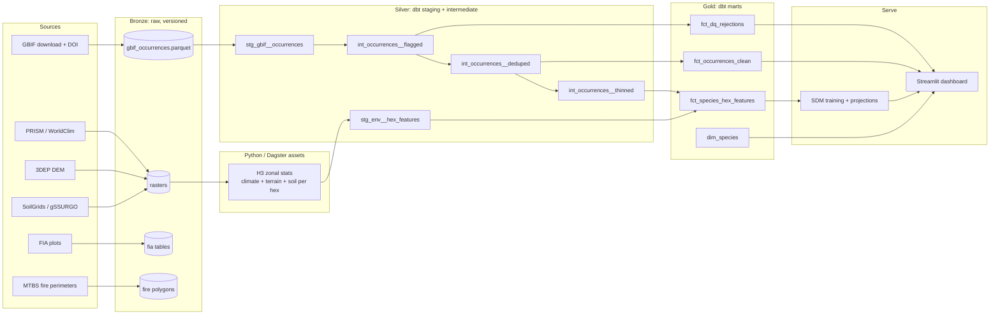

# Cascadia Flora

**An open-data engineering and species distribution modeling pipeline for Pacific Northwest trees.**

> **Core question:** Which Pacific Northwest tree species are most exposed to climate change, and how is suitable habitat shifting along the Cascades' elevation and rain-shadow gradients?

Everything here uses public-access data and free, open-source tools. The pipeline is reproducible end to end: pinned GBIF snapshots, versioned raw data, tested transformations, and a live dashboard.

> **Status:** 🚧 In development. See the [Roadmap](#roadmap) for progress. Items marked `TODO` are placeholders to fill in as you build.

---

## Table of contents

1. [Why the Pacific Northwest](#why-the-pacific-northwest)
2. [Scope](#scope)
3. [Data sources](#data-sources)
4. [Tech stack](#tech-stack)
5. [Architecture](#architecture)
6. [Data cleaning rules](#data-cleaning-rules)
7. [dbt project design](#dbt-project-design)
8. [Data quality and testing](#data-quality-and-testing)
9. [Modeling approach](#modeling-approach)
10. [Analyses](#analyses)
11. [Dashboard](#dashboard)
12. [Repository layout](#repository-layout)
13. [Getting started](#getting-started)
14. [Roadmap](#roadmap)
15. [Limitations and design decisions](#limitations-and-design-decisions)
16. [Data citations and licenses](#data-citations-and-licenses)

---

## Why the Pacific Northwest

- **Steep climate gradients over short distances:** wet western slopes, dry eastern side, and a rain shadow created by the Cascades.
- **Strong citizen-science coverage:** Seattle and Portland are iNaturalist hotspots, which is useful and also a sampling-bias problem worth solving.
- **Real conservation stories:** threatened Garry oak ecosystems, high-elevation species like whitebark pine, and a growing wildfire footprint.
- **Excellent public data:** PRISM climate, USFS Forest Inventory plots, 3DEP elevation, and burn perimeters are all freely available.

---

## Scope

**Region:** Washington and Oregon (optionally extend to northern California).

**Species (start with 3, expand to 8-12):**

| Group | Species | Notes |
|---|---|---|
| Lowland conifers | Douglas-fir, western hemlock, western redcedar, Sitka spruce | Core forest types |
| Hardwoods | Bigleaf maple, red alder | Common, heavily observed |
| Threatened/rare | Garry oak | Rare ecosystem, cultivated records are a cleaning challenge |
| High elevation | Whitebark pine, subalpine fir | Most at risk from warming |
| Invasives (second analysis) | Scotch broom, English ivy, Himalayan blackberry, knotweed | Spread-front analysis |

**Starter set for the first end-to-end pass:** Douglas-fir, Garry oak, whitebark pine. These three cover abundant, rare, and high-elevation cases.

**Time window:** occurrences from 1970 onward, to match the climate normals period.

---

## Data sources

| Need | Source | Access |
|---|---|---|
| Occurrences | [GBIF](https://www.gbif.org) (includes iNaturalist research-grade and herbarium records), [Consortium of Pacific Northwest Herbaria](https://www.pnwherbaria.org) | Free account, download API with DOI |
| Forest survey plots | [USFS FIA DataMart](https://research.fs.usda.gov/products/dataandtools/fia-datamart) | Public download |
| Climate (current) | [PRISM](https://prism.oregonstate.edu) (~800 m), [WorldClim](https://www.worldclim.org) | Public download |
| Climate (future) | WorldClim CMIP6 projections, or MACA / NASA NEX-GDDP | Public download |
| Elevation | USGS 3DEP DEM (derive slope, aspect) | Public |
| Soil | [SoilGrids](https://soilgrids.org), USDA NRCS gSSURGO | Public API / download |
| Satellite imagery | Sentinel-2 / Landsat via [Microsoft Planetary Computer](https://planetarycomputer.microsoft.com) | Free STAC API |
| Land cover | NLCD, LANDFIRE | Public download |
| Wildfire | MTBS burn perimeters and severity, NIFC fire history | Public download |
| Taxonomy and status | [POWO](https://powo.science.kew.org), USDA PLANTS | Public |

---

## Tech stack

| Layer | Tools |
|---|---|
| Ingestion | Python (`pygbif`, `requests`, `rasterio`, `xarray`, `pystac-client`) |
| Orchestration | Dagster (asset-based lineage) with `dagster-dbt` |
| Storage | Parquet files + DuckDB (spatial and `h3` extensions) |
| Spatial indexing | H3 hexagons (resolution 8, ~0.7 km²) |
| Transformation | dbt-core with `dbt-duckdb` |
| Data quality | dbt tests, dbt unit tests, optionally Great Expectations |
| Modeling | scikit-learn, XGBoost, GeoPandas, spatial block cross-validation |
| Serving | Streamlit (Community Cloud) with `pydeck` / `folium` |
| Packaging and CI | Docker, GitHub Actions |

---

## Architecture



### Layers

1. **Bronze:** raw GBIF pulls, rasters, FIA tables, and fire polygons. Untouched and versioned.
2. **Silver:** cleaned, flagged, deduplicated occurrences with standardized taxonomy. Environmental rasters aligned to one CRS and summarized onto an H3 grid.
3. **Gold:** per-species feature tables (climate + soil + terrain per hex), model predictions, range-shift metrics, and a data quality audit table.
4. **Serve:** Streamlit dashboard with species picker, observed vs. predicted range, climate scenario slider, and elevation-shift charts.

### Division of labor: Python vs. dbt

dbt is SQL, so **raster sampling does not happen in dbt.** A Dagster asset in Python computes zonal statistics per H3 hex (climate, soil, terrain) and writes Parquet. dbt reads that Parquet as a source and handles the joins, cleaning logic, and tests. Each tool does what it is best at.

---

## Data cleaning rules

GBIF data is messy. The guiding principle is **flag, don't delete**: every record gets a list of rejection reasons, and the pipeline splits rows into `clean` and `rejected`. That produces an audit trail that is charted in the dashboard.

### 1. Filters at download time (upstream, cheap)

Use a GBIF **download request** instead of paging the search API, with these filters:

- `hasCoordinate = true` and `hasGeospatialIssue = false`
- `occurrenceStatus = PRESENT`
- State/province or a WA + OR polygon
- Selected species `taxonKey`s

Each download gets a **DOI**. Store it in `seeds/gbif_download_manifest.csv` so the whole pipeline is pinned to one citable snapshot.

### 2. Rejection rules applied in the pipeline

| Rule | Logic | Why |
|---|---|---|
| `missing_coordinates` | lat or lon is null | Unusable |
| `zero_or_swapped_coords` | lat = 0 and lon = 0, or lat = lon | Classic data-entry errors |
| `outside_study_area` | Not inside the WA/OR polygon | Catches geocoding errors and stray records |
| `uncertainty_too_high` | `coordinateUncertaintyInMeters` > 1000 | PRISM is ~800 m, so a 5 km error samples the wrong climate |
| `coordinates_too_coarse` | Fewer than 3 decimal places | Rounded to ~11 km or worse |
| `bad_basis_of_record` | Fossil, living specimen, or material sample | Living specimens are botanical gardens and arboreta |
| `cultivated` | `establishmentMeans = MANAGED` | Planted trees are not habitat evidence |
| `pre_1970` | Year < 1970 or null | Match the climate normals period |
| `gbif_geospatial_issue` | Flags such as `COUNTRY_COORDINATE_MISMATCH`, `PRESUMED_SWAPPED_COORDINATE`, `PRESUMED_NEGATED_LONGITUDE` | GBIF already detected these |
| `low_taxon_confidence` | `TAXON_MATCH_NONE` or `TAXON_MATCH_HIGHERRANK` | Wrong or ambiguous species ID |
| `centroid_suspect` | Within ~1 km of a county/state centroid and high uncertainty | Geocoded to a place name, not a real location |

### 3. Rules that flag but keep

These are reviewed rather than auto-dropped, because they may be real signal.

- **Elevation mismatch:** if a record has an elevation, compare it to the DEM. A gap over ~500 m usually means bad coordinates.
- **Environmental outlier:** climate values beyond the 99th percentile for that species. These could be genuine range-edge records, which is where the interesting science is.
- **Urban:** points in NLCD developed classes. Street trees and yard plantings contaminate native-species ranges.

### 4. Deduplication and spatial thinning

1. **Dedup:** the same observation often appears through multiple datasets. Dedupe on species, coordinates rounded to 4 decimals, date, and observer.
2. **Spatial thinning:** keep one record per species per H3 cell. This is the **sampling bias correction**, since iNaturalist is heavily clustered around Seattle and Portland.

Both versions are kept: **thinned** for modeling, **unthinned** for density and trend analyses (for example, the Scotch broom spread).

---

## dbt project design

Layer mapping: `staging` = bronze-to-silver entry, `intermediate` = silver, `marts` = gold.

```
dbt/
├── dbt_project.yml
├── seeds/
│   ├── species_list.csv              # taxon keys, common names, group
│   └── gbif_download_manifest.csv    # DOI, date, filters
├── macros/
│   └── h3_cell.sql
├── models/
│   ├── staging/
│   │   ├── gbif/   stg_gbif__occurrences.sql, _gbif__sources.yml, _gbif__models.yml
│   │   ├── fia/    stg_fia__trees.sql
│   │   └── env/    stg_env__hex_features.sql
│   ├── intermediate/
│   │   ├── int_occurrences__flagged.sql
│   │   ├── int_occurrences__deduped.sql
│   │   └── int_occurrences__thinned.sql
│   └── marts/
│       ├── ecology/  dim_species.sql, fct_occurrences_clean.sql, fct_species_hex_features.sql
│       └── audit/    fct_dq_rejections.sql
└── tests/
```

### Source definition

```yaml
# _gbif__sources.yml
sources:
  - name: bronze
    meta:
      external_location: "../data/bronze/{name}/*.parquet"
    tables:
      - name: gbif_occurrences
      - name: env_hex_features
```

### Staging: rename, cast, nothing else

```sql
-- stg_gbif__occurrences.sql
select
    cast(gbifID as bigint)                          as gbif_id,
    cast(speciesKey as integer)                     as species_key,
    species                                         as species_name,
    cast(decimalLatitude as double)                 as lat,
    cast(decimalLongitude as double)                as lon,
    cast(coordinateUncertaintyInMeters as double)   as uncertainty_m,
    basisOfRecord                                   as basis_of_record,
    establishmentMeans                              as establishment_means,
    cast(year as integer)                           as event_year,
    try_cast(left(eventDate, 10) as date)           as event_date,
    recordedBy                                      as recorded_by,
    issue
from {{ source('bronze', 'gbif_occurrences') }}
```

This assumes `issue` arrives as a semicolon-delimited string. Adjust if your download provides a list.

### Intermediate: the flagging model

```sql
-- int_occurrences__flagged.sql
with base as (
    select * from {{ ref('stg_gbif__occurrences') }}
)
select
    *,
    list_filter([
        case when lat is null or lon is null then 'missing_coordinates' end,
        case when lat = lon or (lat = 0 and lon = 0) then 'zero_or_swapped_coords' end,
        case when lat not between 41.9 and 49.1
               or lon not between -124.9 and -116.4 then 'outside_study_area' end,
        case when uncertainty_m > 1000 then 'uncertainty_too_high' end,
        case when basis_of_record in ('FOSSIL_SPECIMEN','LIVING_SPECIMEN','MATERIAL_SAMPLE')
             then 'bad_basis_of_record' end,
        case when establishment_means = 'MANAGED' then 'cultivated' end,
        case when event_year is null or event_year < 1970 then 'pre_1970' end,
        case when contains(issue, 'COUNTRY_COORDINATE_MISMATCH')
               or contains(issue, 'PRESUMED_SWAPPED_COORDINATE')
               or contains(issue, 'PRESUMED_NEGATED_LONGITUDE') then 'gbif_geospatial_issue' end,
        case when contains(issue, 'TAXON_MATCH_NONE')
               or contains(issue, 'TAXON_MATCH_HIGHERRANK') then 'low_taxon_confidence' end
    ], x -> x is not null) as rejection_reasons
from base
```

The bounding box is a fast first pass. Replace it with an exact `ST_Within` against Census state polygons using DuckDB's spatial extension.

### Deduplication and thinning

```sql
-- int_occurrences__deduped.sql
select * from {{ ref('int_occurrences__flagged') }}
where len(rejection_reasons) = 0
qualify row_number() over (
    partition by species_key, round(lat, 4), round(lon, 4), event_date, recorded_by
    order by uncertainty_m nulls last, gbif_id
) = 1
```

```sql
-- int_occurrences__thinned.sql
select *, {{ h3_cell('lat', 'lon', 8) }} as h3_r8
from {{ ref('int_occurrences__deduped') }}
qualify row_number() over (
    partition by species_key, h3_r8
    order by uncertainty_m nulls last, event_date desc
) = 1
```

```sql
-- macros/h3_cell.sql

    h3_latlng_to_cell_string({{ lat }}, {{ lon }}, {{ res }})

```

H3 resolution 8 (~0.7 km² cells) is close to PRISM's 800 m grid. The `h3` extension is a DuckDB community extension, and dbt-duckdb can load it through the `extensions` setting in your profile.

### Audit mart

```sql
-- fct_dq_rejections.sql
with exploded as (
    select species_name, unnest(rejection_reasons) as reason
    from {{ ref('int_occurrences__flagged') }}
)
select species_name, reason, count(*) as n_records
from exploded
group by all
```

This feeds the "why records were rejected, per species" chart in the dashboard.

### Lineage and exposures

- `dbt docs generate` produces the lineage graph (screenshot it into `docs/`).
- The Streamlit app is declared as a dbt **exposure** so lineage extends to the dashboard.
- `dagster-dbt` loads every dbt model as a Dagster asset, so ingestion, transformations, and model training appear in a single lineage graph.

---

## Data quality and testing

**Generic tests (YAML):**
- `unique` and `not_null` on `gbif_id`
- `accepted_values` on `basis_of_record`
- `relationships` from `species_key` to `dim_species`
- `dbt_utils.accepted_range` on lat/lon in the clean fact table

**Singular tests (SQL in `tests/`, should return zero rows):**
- No clean record has uncertainty over 1000 m
- Every species in the seed has at least N clean records (`severity: warn`, since whitebark pine may be thin)
- Rejection share per species stays under a threshold (warns on drift between GBIF snapshots)

**Unit tests (dbt 1.8+) for the flagging logic:**

```yaml
unit_tests:
  - name: flags_high_uncertainty
    model: int_occurrences__flagged
    given:
      - input: ref('stg_gbif__occurrences')
        rows:
          - {gbif_id: 1, lat: 47.6, lon: -122.3, uncertainty_m: 5000,
             basis_of_record: HUMAN_OBSERVATION, event_year: 2020, issue: ''}
    expect:
      rows:
        - {gbif_id: 1, rejection_reasons: ['uncertainty_too_high']}
```

**Python tests:** `pytest` for ingestion helpers and zonal-stats functions, run in GitHub Actions on every push.

---

## Modeling approach

`TODO: fill in results as you build.`

- **Problem:** species distribution modeling (SDM), predicting habitat suitability from climate, terrain, and soil.
- **Presence data:** thinned occurrences from `fct_occurrences_clean`.
- **Background / pseudo-absence points:** sampled using a **target-group background** (records of other plant species as a proxy for observer effort) to counter iNaturalist sampling bias.
- **Features:** bioclimatic variables (for example mean annual temperature, annual precipitation, precipitation seasonality), elevation, slope, aspect, soil pH, soil organic carbon, soil texture. Remove highly correlated variables (check VIF or pairwise correlation).
- **Algorithms:** logistic regression baseline, random forest, and XGBoost. Optionally compare with a MaxEnt-style model.
- **Validation:** **spatial block cross-validation** (not random splits) to avoid inflated scores from spatial autocorrelation. Metrics: AUC, TSS, and Boyce index. Independently check predictions against **FIA plot** presence/absence.
- **Projections:** apply the trained model to future climate (2050 and 2070, one or two SSP scenarios) and compare suitability to the present.

---

## Analyses

| Analysis | Question | Output |
|---|---|---|
| **Range shift** | How much suitable habitat is gained, lost, or stable by 2050/2070? | Per-species gain/loss/stable area |
| **Elevation shift** | How far upslope does each species' suitable habitat move? | Median occurrence elevation vs. projected suitable elevation |
| **Rain-shadow transect** | How does suitability change across a west-to-east line over the Cascades? | Transect profile chart |
| **Vulnerability ranking** | Which species are most exposed to a +2°C shift? | Ranked table in the dashboard |
| **Fire overlay** | What share of projected suitable habitat falls within recent burn perimeters? | Overlap percentages using MTBS |
| **Invasive front** | How are Scotch broom and other invasives spreading over time? | Occurrences per year, animated map (uses the unthinned table) |
| **Data quality audit** | Why were records rejected, and how does that differ by species? | Charts from `fct_dq_rejections` |

---

## Dashboard

Built with Streamlit, deployed on Streamlit Community Cloud. `TODO: add live demo link and screenshot.`

Planned views:
- **Species explorer:** pick a species and see observed points vs. predicted suitability.
- **Climate scenario slider:** current, 2050, 2070.
- **Elevation shift chart:** historical vs. projected elevation range.
- **Transect view:** suitability across the Cascades.
- **Data quality tab:** rejection reasons per species.
- **Methods tab:** short explanation of data, cleaning, and modeling choices.

---

## Repository layout

```
cascadia-flora/
├── pipelines/          # Dagster assets: ingest_gbif, ingest_prism, h3_zonal_stats, ...
├── dbt/                # staging, intermediate, marts, seeds, tests
├── models/             # SDM training, evaluation, projections
├── app/                # Streamlit dashboard
├── data/               # bronze/ silver/ gold/ (git-ignored; documented in docs/)
├── tests/              # Python unit tests and data quality checks
├── docs/               # architecture diagram, data dictionary, lineage screenshots
├── .github/workflows/  # CI: lint, pytest, dbt build on a sample dataset
├── Dockerfile
├── pyproject.toml
└── README.md
```

---

## Getting started

`TODO: confirm commands once the project is built.`

```bash
# 1. Clone and set up the environment
git clone https://github.com/<your-username>/cascadia-flora.git
cd cascadia-flora
python -m venv .venv && source .venv/bin/activate
pip install -e ".[dev]"

# 2. Configure credentials (free GBIF account)
cp .env.example .env     # add GBIF_USER, GBIF_PWD, GBIF_EMAIL

# 3. Run the pipeline through Dagster
dagster dev              # open the UI and materialize all assets

# 4. Or run dbt directly
cd dbt && dbt deps && dbt build

# 5. Launch the dashboard
streamlit run app/main.py
```

Docker alternative: `docker compose up`.

---

## Roadmap

**Week 1: Foundations**
- [ ] Repo, environment, and CI setup
- [ ] Species list seed and GBIF download with DOI manifest
- [ ] Bronze storage in Parquet

**Week 2: Cleaning and environmental data**
- [ ] dbt staging and flagging models
- [ ] Data quality tests and unit tests
- [ ] PRISM, DEM, and soil ingestion

**Week 3: Spatial enrichment**
- [ ] H3 zonal-stats Dagster asset
- [ ] Dedup and thinning models
- [ ] Gold marts and audit table

**Week 4: Modeling**
- [ ] Target-group background sampling
- [ ] Baseline and XGBoost SDMs with spatial block CV
- [ ] FIA validation

**Week 5: Projections and analysis**
- [ ] Future climate ingestion
- [ ] Range-shift and elevation-shift metrics
- [ ] Fire overlay and invasive-front analyses

**Week 6: Delivery**
- [ ] Streamlit dashboard
- [ ] Architecture diagram and lineage screenshots
- [ ] Write-up of findings and deployment

**Stretch goals**
- [ ] Add remaining species and the invasive set
- [ ] NDVI trends from Sentinel-2 or Landsat via Planetary Computer
- [ ] Scheduled refresh with GitHub Actions or Dagster schedules

---

## Limitations and design decisions

`TODO: expand with real findings.`

- **Sampling bias:** citizen-science data clusters near cities and trails. Mitigated through spatial thinning and target-group background sampling, but not eliminated.
- **Presence-only data:** there are no true absences, so models predict relative suitability, not probability of occurrence.
- **Climate-only niche:** SDMs capture the climatic and edaphic niche, not dispersal, competition, or disturbance such as fire and disease.
- **Resolution mismatch:** coordinate uncertainty, PRISM (~800 m), and H3 resolution 8 are deliberately aligned, but finer local effects (microclimate) are not captured.
- **Why DuckDB over a hosted warehouse:** free, local, fast for this data size, and has spatial and H3 extensions.
- **Why flag-don't-delete:** keeps the audit trail honest and lets reviewers see exactly what was excluded and why.
- **Why dbt for the cleaning logic:** rules are transparent, testable, and documented in lineage rather than buried in scripts.

---

## Data citations and licenses

- GBIF.org, *GBIF Occurrence Download*, `TODO: DOI from your download manifest`.
- PRISM Climate Group, Oregon State University.
- WorldClim (Fick and Hijmans, 2017).
- SoilGrids (ISRIC World Soil Information).
- USDA Forest Service, Forest Inventory and Analysis (FIA) DataMart.
- USGS 3D Elevation Program.
- MTBS (Monitoring Trends in Burn Severity).
- Kew Plants of the World Online (POWO).

Check each source's license and citation requirements before publishing results. GBIF records carry per-dataset licenses (CC0, CC BY, or CC BY-NC), and the download DOI handles attribution.

**Code license:** `TODO: choose (MIT is a common choice for portfolio projects).`
