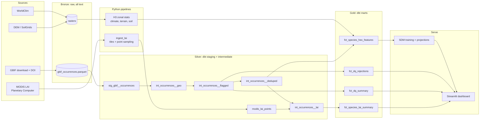

# Cascadia Flora

**An open-data engineering and species distribution modeling pipeline for Pacific Northwest trees.**

> **Core question:** Which Cascadian tree species are most exposed to climate change, and how is suitable habitat shifting along the Cascades' elevation and rain-shadow gradients?

Everything here uses public-access data and free, open-source tools. The pipeline is reproducible end to end: pinned GBIF snapshots (with DOIs), versioned raw data, tested transformations, and a live dashboard.

> **Status:** 🚧 In development. Ingestion, bronze storage and the dbt cleaning layer are built. Satellite leaf-area-index (LAI) enrichment is in progress. Modeling and the dashboard are not started. See the [Roadmap](#roadmap). Items marked `TODO` are placeholders to fill in as results come in.

---

## Table of contents

1. [Why Cascadia](#why-cascadia)
2. [Scope](#scope)
3. [Data sources](#data-sources)
4. [Tech stack](#tech-stack)
5. [Architecture](#architecture)
6. [Data cleaning rules](#data-cleaning-rules)
7. [Baseline findings](#baseline-findings)
8. [Satellite enrichment: leaf area index](#satellite-enrichment-leaf-area-index)
9. [dbt project design](#dbt-project-design)
10. [Data quality and testing](#data-quality-and-testing)
11. [Modeling approach](#modeling-approach)
12. [Analyses](#analyses)
13. [Dashboard](#dashboard)
14. [Repository layout](#repository-layout)
15. [Getting started](#getting-started)
16. [Roadmap](#roadmap)
17. [Limitations and design decisions](#limitations-and-design-decisions)
18. [Data citations and licenses](#data-citations-and-licenses)

---

## Why Cascadia

- **Steep climate gradients over short distances:** wet western slopes, dry eastern side, and a rain shadow created by the Cascades.
- **Strong citizen-science coverage:** Seattle, Portland and Vancouver are iNaturalist hotspots, which is useful and also a sampling-bias problem worth solving.
- **Real conservation stories:** threatened Garry oak ecosystems, high-elevation species like whitebark pine, and a growing wildfire footprint.
- **Excellent public data:** climate, satellite, forest inventory, elevation and burn perimeters are all freely available.
- **Ecologically coherent region:** the Cascadia bioregion does not stop at the 49th parallel, so the study area includes southwestern British Columbia.

---

## Scope

**Region:** Washington, Oregon and southwestern British Columbia. The study area is a polygon (state and province outlines, plus a small coastal buffer, clipped to the download box `-128.5, 41.9, -116.4, 51.0`) stored as a dbt seed in `dbt/seeds/study_area.csv`. The same box is used as the geometry filter in the GBIF download request. Neighboring regions (Idaho, California, Alberta) are excluded by the polygon check, not just by the box.

**Species (start with 3, expand to 8-12):**

| Group | Species | Notes |
|---|---|---|
| Lowland conifers | Douglas-fir, western hemlock, western redcedar, Sitka spruce | Core forest types |
| Hardwoods | Bigleaf maple, red alder | Common, heavily observed |
| Threatened/rare | Garry oak | Rare ecosystem, cultivated records are a cleaning challenge |
| High elevation | Whitebark pine, subalpine fir | Most at risk from warming |
| Invasives (second analysis) | Scotch broom, English ivy, Himalayan blackberry, knotweed | Spread-front analysis |

Species are resolved to GBIF backbone taxon keys by `scripts/build_species_seed.py`, which writes `dbt/seeds/species_list.csv`.

**Starter set for the first end-to-end pass:** Douglas-fir, Garry oak, whitebark pine. These three cover abundant, rare, and high-elevation cases.

**Time window:** occurrences from 1970 onward, to match the climate normals period.

---

## Data sources

| Need | Source | Access | Status |
|---|---|---|---|
| Occurrences | [GBIF](https://www.gbif.org) (includes iNaturalist research-grade and herbarium records), [Consortium of Pacific Northwest Herbaria](https://www.pnwherbaria.org) | Free account, download API with DOI | In use (GBIF) |
| Leaf area index | NASA MODIS MOD15A2H v061 (Terra, 8-day, 500 m) via [Microsoft Planetary Computer](https://planetarycomputer.microsoft.com) | Free STAC API | Code written, first real run pending |
| Climate (current) | [WorldClim](https://www.worldclim.org) 2.1 (~1 km) | Public download | Planned |
| Climate (future) | WorldClim CMIP6 projections | Public download | Planned |
| Elevation | Copernicus DEM GLO-30 (covers Canada and the US; derive slope, aspect) | Public, via Planetary Computer | Planned |
| Soil | [SoilGrids](https://soilgrids.org) | Public API / download | Planned |
| Forest survey plots | [USFS FIA DataMart](https://research.fs.usda.gov/products/dataandtools/fia-datamart) | Public download | Planned (US only) |
| Land cover | NLCD (US), LANDFIRE; a Canadian equivalent is needed for BC | Public download | Planned |
| Wildfire | MTBS (US) and the Canadian National Burned Area Composite | Public download | Planned |
| Taxonomy and status | [POWO](https://powo.science.kew.org), USDA PLANTS | Public | Planned |

**Why WorldClim and not PRISM:** PRISM does not cover Canada, and WorldClim also provides the future projections the model needs, so one source covers the whole study area, present and future.

**Coverage caveat:** FIA, NLCD and MTBS are US-only. Any validation that depends on them applies to the Washington and Oregon part of the study area only, and this is stated in the results.

---

## Tech stack

| Layer | Tools |
|---|---|
| Ingestion | Python (`requests` against the GBIF REST API, `rasterio`, `pystac-client`, `planetary-computer`) |
| Orchestration | Dagster (asset-based lineage) with `dagster-dbt`, planned |
| Storage | Parquet files + DuckDB (spatial extension; `h3` extension planned) |
| Spatial indexing | H3 hexagons (resolution 8, ~0.7 km²), planned |
| Transformation | dbt-core with `dbt-duckdb` |
| Data quality | dbt tests, dbt unit tests |
| Modeling | scikit-learn, XGBoost, GeoPandas, spatial block cross-validation |
| Serving | Streamlit (Community Cloud) with `pydeck` / `folium` |
| Packaging and CI | `pyproject.toml` (hatchling), ruff, pytest, GitHub Actions; Docker planned |

---

## Architecture



The thinning model, hex features and everything after them are planned. Everything up to `int_occurrences__deduped` exists today.

### Layers

1. **Bronze:** raw GBIF pulls and rasters, untouched. GBIF data is stored with every column as text, so typing mistakes cannot silently change the raw data.
2. **Silver:** typed, flagged, deduplicated occurrences, plus per-point satellite values.
3. **Gold:** audit tables, per-species summaries, feature tables and model outputs.
4. **Serve:** Streamlit dashboard with species picker, observed vs. predicted range, climate scenario slider, and elevation-shift charts.

### Division of labor: Python vs. dbt

dbt is SQL, so **raster work does not happen in dbt.** Python reads rasters (MODIS tiles, later climate and terrain) and writes Parquet. dbt reads that Parquet as a source and handles the joins, cleaning logic, and tests. Each tool does what it is best at.

---

## Data cleaning rules

GBIF data is messy. The guiding principle is **flag, don't delete**: every record gets a list of rejection reasons, and the pipeline splits rows into `clean` and `rejected`. That produces an audit trail that is charted in the dashboard.

### 1. Filters at download time (upstream, cheap)

Use a GBIF **download request** instead of paging the search API, with these filters:

- `HAS_COORDINATE = true` and `HAS_GEOSPATIAL_ISSUE = false`
- `OCCURRENCE_STATUS = PRESENT`
- A `within` geometry: the Cascadia download box (counter-clockwise WKT, which GBIF requires)
- Selected species `TAXON_KEY`s

Each download gets a **DOI**. It is recorded in `dbt/seeds/gbif_download_manifest.csv` so the whole pipeline is pinned to one citable snapshot.

### 2. Rejection rules applied in the pipeline

Thresholds live in `dbt_project.yml` vars, so they can be changed in one place.

| Rule | Logic | Why |
|---|---|---|
| `missing_coordinates` | lat or lon is null | Unusable |
| `zero_or_swapped_coords` | lat = 0 and lon = 0, or lat = lon | Classic data-entry errors |
| `outside_study_area` | Not inside the study-area polygon (`ST_Within`) | Catches geocoding errors, stray records, and the corners of the download box that fall in Idaho, California or Alberta |
| `uncertainty_too_high` | `coordinateUncertaintyInMeters` > 1000 (`max_uncertainty_m`) | WorldClim is ~1 km, so a 5 km error samples the wrong climate |
| `coordinates_too_coarse` | Fewer than 3 decimal places (`min_coordinate_decimals`), judged on the lower of latitude and longitude | Rounded to ~100 m at best, ~11 km at worst |
| `bad_basis_of_record` | Fossil, living specimen, or material sample | Living specimens are botanical gardens and arboreta |
| `cultivated` | `establishmentMeans = MANAGED` | Planted trees are not habitat evidence |
| `year_out_of_range` | Year before 1970 (`min_year`), in the future, or null | Match the climate normals period |
| `gbif_geospatial_issue` | Flags such as `COUNTRY_COORDINATE_MISMATCH`, `PRESUMED_SWAPPED_COORDINATE`, `PRESUMED_NEGATED_LONGITUDE` | GBIF already detected these |
| `low_taxon_confidence` | `TAXON_MATCH_NONE` or `TAXON_MATCH_HIGHERRANK` | Wrong or ambiguous species ID |
| `centroid_suspect` *(planned)* | Within ~1 km of a county/state centroid and high uncertainty | Geocoded to a place name, not a real location |

### 3. Rules that flag but keep

These are reviewed rather than auto-dropped, because they may be real signal. They live in `review_flags`, separate from `rejection_reasons`.

- **`uncertainty_missing`:** about a fifth of records have no uncertainty value. They are kept and flagged, since dropping them would remove a large share of legitimate observations.
- **Elevation mismatch** *(planned):* if a record has an elevation, compare it to the DEM. A gap over ~500 m usually means bad coordinates.
- **Environmental outlier** *(planned):* climate values beyond the 99th percentile for that species. These could be genuine range-edge records, which is where the interesting science is.
- **Urban** *(planned):* points in developed land-cover classes. Street trees and yard plantings contaminate native-species ranges.

### 4. Deduplication and spatial thinning

1. **Dedup** *(built):* the same observation often appears through multiple datasets. Dedupe on species, coordinates rounded to 4 decimals, date, and observer.
2. **Spatial thinning** *(planned)*: keep one record per species per H3 cell. This is the **sampling bias correction**, since iNaturalist is heavily clustered around Seattle, Portland and Vancouver.

Both versions are kept: **thinned** for modeling, **unthinned** for density and trend analyses (for example, the Scotch broom spread).

---

## Baseline findings

From the first GBIF pull, which used the earlier, looser download box. `TODO: refresh these numbers after the redownload with the Cascadia box.`

- **42,590 records** downloaded.
- **About 95% are from 2010 onward.** The 1970 cutoff barely matters, so recency is not a problem. Temporal sampling is skewed toward the iNaturalist era.
- **About 20% have no coordinate uncertainty.** This is why missing uncertainty is a review flag and not a rejection.
- **92.8% are `HUMAN_OBSERVATION`**, which is mostly citizen science.
- **`establishmentMeans` is essentially empty**, so the `cultivated` rule rarely fires. Cultivated and planted trees will need a proxy, such as the urban land-cover flag.
- **About a third of records (13,852) were in Canada**, which confirmed that southwestern BC belongs in the study area rather than being cut off at the border.

---

## Satellite enrichment: leaf area index

**Question:** how leafy is the canopy at each occurrence record, and how does LAI vary across the region and by species?

**Data:** MODIS MOD15A2H (Terra), an 8-day, 500 m product on the sinusoidal grid, accessed through the Planetary Computer STAC API. The LAI band is stored as an integer with a scale factor of 0.1.

**Pipeline (`pipelines/ingest_lai.py`):**

1. Search STAC for tiles covering the study box for each year in the window (default 2019 to 2023).
2. Keep only July and August composites, the peak growing season, so the values are comparable across the region.
3. Mask low-quality pixels using the `FparLai_QC` band (good retrieval, clear sky, little snow or cloud contamination) and drop fill and land-cover codes (water, urban, barren, snow/ice, all stored as values above 100).
4. Accumulate a per-pixel summer mean, peak and observation count, and cache each tile so reruns resume rather than redownload.
5. **Region product:** mosaic the tiles, mask to the study-area polygon, and write a GeoTIFF, a PNG map and a JSON summary of statistics.
6. **Point pairing:** transform each occurrence's longitude and latitude into the sinusoidal grid and read the pixel value, writing `data/silver/modis_lai_points/lai_points.parquet` with `gbif_id`, `lai_summer_mean`, `lai_summer_max`, `lai_n_obs` and `modis_tile`.

dbt then joins that Parquet onto `int_occurrences__deduped` by `gbif_id` and summarizes LAI by species. `TODO: models int_occurrences__lai and fct_species_lai_summary are planned, not built yet.`

**Interpretation caveats:**

- A 500 m pixel mixes everything inside it. A tree observed beside a clearcut or a road gets the average, not the LAI of its own canopy.
- MODIS reports no LAI for urban areas or water, so urban records come back empty. Count them rather than treating them as zero.
- LAI saturates in dense old-growth conifer forest, so differences among the highest values are weak evidence.
- LAI describes the site, not the species. It is a useful environmental feature and a sanity check, not a species trait.

**Status:** the code is written, but a first real run against the Planetary Computer has not happened yet, and the map and statistics in this section will be added after it. `TODO: add the map and region summary here.`

---

## dbt project design

Layer mapping: `staging` = bronze-to-silver entry, `intermediate` = silver, `marts` = gold.

```
dbt/
├── dbt_project.yml
├── profiles.yml                      # targets: dev (file) and ci (in-memory)
├── seeds/
│   ├── species_list.csv              # taxon keys, common names, group
│   ├── study_area.csv                # one WKT polygon: the Cascadia study area
│   └── gbif_download_manifest.csv    # DOI, date, filters
├── models/
│   ├── staging/gbif/      stg_gbif__occurrences.sql + source and model yml
│   ├── intermediate/      int_occurrences__geo.sql, __flagged.sql, __deduped.sql
│   └── marts/audit/       fct_dq_rejections.sql, fct_dq_summary.sql
└── tests/                            # singular tests
```

Planned additions: `int_occurrences__thinned`, `int_occurrences__lai`, `fct_species_lai_summary`, `dim_species`, and the hex feature tables.

### Source definition

Sources are read directly from Parquet through dbt-duckdb's `external_location`. Bronze is all text, and typing happens in staging.

```yaml
sources:
  - name: bronze
    tables:
      - name: gbif_occurrences
        config:
          external_location: "read_parquet('../data/bronze/{name}/*.parquet')"
```

### Staging: rename, cast, nothing else

Casts use `try_cast`, so one malformed value becomes a null that a rule can flag instead of failing the whole build.

### Intermediate

- **`int_occurrences__geo`** adds `in_study_area` using `ST_Within` against the polygon seed (DuckDB spatial extension).
- **`int_occurrences__flagged`** builds `rejection_reasons` (a list) and `review_flags` from the rules above, with thresholds read from vars, plus `is_clean` and text versions of the lists for easy filtering.
- **`int_occurrences__deduped`** keeps clean records only, one per species, rounded coordinates, date and observer, preferring the lowest uncertainty.

### Audit marts

- **`fct_dq_rejections`** is one row per species and reason, with a count. It feeds the "why records were rejected, per species" chart.
- **`fct_dq_summary`** is one row per species with total, rejected, clean and clean-after-dedup counts.

### Lineage and exposures

- `dbt docs generate` produces the lineage graph (screenshot it into `docs/`).
- The Streamlit app will be declared as a dbt **exposure** so lineage extends to the dashboard.
- `dagster-dbt` will load every dbt model as a Dagster asset, so ingestion, transformations, and model training appear in a single lineage graph.

---

## Data quality and testing

**Generic tests (YAML):**
- `unique` and `not_null` on `gbif_id`
- `accepted_values` on `basis_of_record`
- `relationships` from `species_key` to the species seed
- Range checks on latitude, longitude and (planned) LAI between 0 and 10

**Singular tests (SQL in `dbt/tests/`, should return zero rows):**
- No clean record has uncertainty over the threshold
- Every record flagged outside the study area is rejected
- Rejection share per species stays under a threshold (warns on drift between GBIF snapshots)

**Unit tests (dbt 1.8+)** cover each flagging rule with mocked input rows, so the logic is checked without real data:

```yaml
unit_tests:
  - name: flags_high_uncertainty
    model: int_occurrences__flagged
    given:
      - input: ref('int_occurrences__geo')
        rows:
          - {gbif_id: 1, lat: 47.6, lon: -122.3, uncertainty_m: 5000,
             basis_of_record: HUMAN_OBSERVATION, event_year: 2020, issue: ''}
    expect:
      rows:
        - {gbif_id: 1, rejection_reasons: ['uncertainty_too_high']}
```

**Python tests:** `pytest` for the species seed, the GBIF request builder, the bronze loader, the study-area polygon (known cities inside, known neighbors outside) and, in progress, the LAI functions. CI runs `ruff` and `pytest -m "not slow"` on every push. `TODO: add a CI job for dbt unit tests.`

---

## Modeling approach

`TODO: fill in results as you build.`

- **Problem:** species distribution modeling (SDM), predicting habitat suitability from climate, terrain, soil and canopy features.
- **Presence data:** thinned occurrences.
- **Background / pseudo-absence points:** sampled using a **target-group background** (records of other plant species as a proxy for observer effort) to counter iNaturalist sampling bias.
- **Features:** bioclimatic variables (for example mean annual temperature, annual precipitation, precipitation seasonality), elevation, slope, aspect, soil pH, soil organic carbon, soil texture, and summer LAI. LAI is a present-day feature only, since there is no future LAI projection, so it will be tested as an optional extra and not used in future projections. Remove highly correlated variables (check VIF or pairwise correlation).
- **Algorithms:** logistic regression baseline, random forest, and XGBoost. Optionally compare with a MaxEnt-style model.
- **Validation:** **spatial block cross-validation** (not random splits) to avoid inflated scores from spatial autocorrelation. Metrics: AUC, TSS, and Boyce index. Independently check predictions against **FIA plot** presence/absence (US part of the region only).
- **Projections:** apply the trained model to future climate (2050 and 2070, one or two SSP scenarios) and compare suitability to the present.

---

## Analyses

| Analysis | Question | Output |
|---|---|---|
| **Range shift** | How much suitable habitat is gained, lost, or stable by 2050/2070? | Per-species gain/loss/stable area |
| **Elevation shift** | How far upslope does each species' suitable habitat move? | Median occurrence elevation vs. projected suitable elevation |
| **Rain-shadow transect** | How does suitability change across a west-to-east line over the Cascades? | Transect profile chart |
| **Canopy (LAI) profile** | What summer LAI do records of each species sit in, and how does LAI change across the Cascades? | Regional LAI map, per-species LAI distributions |
| **Vulnerability ranking** | Which species are most exposed to a +2°C shift? | Ranked table in the dashboard |
| **Fire overlay** | What share of projected suitable habitat falls within recent burn perimeters? | Overlap percentages |
| **Invasive front** | How are Scotch broom and other invasives spreading over time? | Occurrences per year, animated map (uses the unthinned table) |
| **Data quality audit** | Why were records rejected, and how does that differ by species? | Charts from `fct_dq_rejections` |

---

## Dashboard

Built with Streamlit, deployed on Streamlit Community Cloud. `TODO: add live demo link and screenshot.`

Planned views:
- **Species explorer:** pick a species and see observed points vs. predicted suitability.
- **Climate scenario slider:** current, 2050, 2070.
- **Elevation shift chart:** historical vs. projected elevation range.
- **Canopy view:** regional LAI map and per-species LAI.
- **Transect view:** suitability across the Cascades.
- **Data quality tab:** rejection reasons per species.
- **Methods tab:** short explanation of data, cleaning, and modeling choices.

---

## Repository layout

```
cascadia-flora/
├── pipelines/          # study_area.py, ingest_gbif.py, bronze_gbif.py, ingest_lai.py (Dagster assets later)
├── scripts/            # build_species_seed.py, build_study_area.py
├── dbt/                # seeds, staging, intermediate, marts, tests
├── models/             # SDM training, evaluation, projections (planned)
├── app/                # Streamlit dashboard (planned)
├── data/               # bronze/ silver/ gold/ (git-ignored)
├── tests/              # Python unit tests
├── docs/               # week notes, data dictionary, lineage screenshots
├── .github/workflows/  # CI: lint and pytest
├── pyproject.toml
└── README.md
```

---

## Getting started

```bash
# 1. Clone and set up the environment
git clone https://github.com/Kaboto731/cascadia-flora.git
cd cascadia-flora
python -m venv .venv && source .venv/bin/activate
pip install -e ".[dev,geo,ml]"

# 2. Configure credentials (free GBIF account)
cp .env.example .env     # add GBIF_USER, GBIF_PWD, GBIF_EMAIL

# 3. Build the seeds
python scripts/build_species_seed.py
python scripts/build_study_area.py

# 4. Download GBIF occurrences and load bronze
python -m pipelines.ingest_gbif request        # prints a download key
python -m pipelines.ingest_gbif fetch <key>    # once GBIF reports SUCCEEDED
python -m pipelines.bronze_gbif <key>          # writes Parquet, manifest, baseline notes

# 5. Clean with dbt
cd dbt && dbt seed && dbt build && cd ..

# 6. Satellite LAI (needs internet access to the Planetary Computer)
python -m pipelines.ingest_lai build           # regional map and statistics
python -m pipelines.ingest_lai points          # LAI at every occurrence
```

If you hit a dependency conflict between dbt and other packages, use a fresh virtual environment and install only the extras you need.

Planned: `dagster dev` to run everything as assets, `streamlit run app/main.py` for the dashboard, and `docker compose up`.

---

## Roadmap

**Week 1: Foundations**
- [x] Repo, environment, and CI setup
- [x] Species list seed and GBIF download with DOI manifest
- [x] Bronze storage in Parquet and baseline stats

**Week 2: Cleaning**
- [x] dbt staging, geo and flagging models
- [x] Data quality tests and unit tests
- [ ] Redownload with the Cascadia box and run `dbt build` on the real data
- [ ] Climate (WorldClim), DEM and soil ingestion

**Week 3: Spatial enrichment**
- [ ] Satellite LAI: first real run, region map, per-occurrence values (code written)
- [ ] LAI join and per-species summary models in dbt
- [ ] H3 zonal-stats asset
- [ ] Thinning model, gold marts

**Week 4: Modeling**
- [ ] Target-group background sampling
- [ ] Baseline and XGBoost SDMs with spatial block CV
- [ ] FIA validation (US part of the region)

**Week 5: Projections and analysis**
- [ ] Future climate ingestion
- [ ] Range-shift and elevation-shift metrics
- [ ] Fire overlay and invasive-front analyses

**Week 6: Delivery**
- [ ] Streamlit dashboard
- [ ] Architecture diagram and lineage screenshots
- [ ] Write-up of findings and deployment

**Stretch goals**
- [ ] Add remaining species and the invasive set
- [ ] NDVI or LAI trends through time
- [ ] Scheduled refresh with GitHub Actions or Dagster schedules

---

## Limitations and design decisions

`TODO: expand with real findings.`

- **Sampling bias:** citizen-science data clusters near cities and trails. Mitigated through spatial thinning and target-group background sampling, but not eliminated.
- **Presence-only data:** there are no true absences, so models predict relative suitability, not probability of occurrence.
- **Climate-only niche:** SDMs capture the climatic and edaphic niche, not dispersal, competition, or disturbance such as fire and disease.
- **Resolution mismatch:** coordinate uncertainty (1 km threshold), WorldClim (~1 km), MODIS (500 m) and H3 resolution 8 are deliberately kept in the same range, but finer local effects (microclimate) are not captured.
- **Uneven coverage across the border:** the US part has FIA, NLCD and MTBS. The BC part relies on GBIF, WorldClim and satellite data. Results are reported with that in mind.
- **Satellite pairing is pixel-level:** a 500 m LAI value describes the neighborhood of an observation, not the tree.
- **Why Cascadia and not WA + OR:** the ecosystems cross the border. Cutting at 49°N would remove about a third of the available records and an obvious part of the range.
- **Why WorldClim over PRISM:** PRISM stops at the US border. WorldClim covers the whole region and includes future projections.
- **Why DuckDB over a hosted warehouse:** free, local, fast for this data size, and has spatial and H3 extensions.
- **Why flag-don't-delete:** keeps the audit trail honest and lets reviewers see exactly what was excluded and why.
- **Why dbt for the cleaning logic:** rules are transparent, testable, and documented in lineage rather than buried in scripts.
- **Why bronze is all text:** raw data stays untouched, and typing happens in one place, with `try_cast` turning bad values into flaggable nulls.

---

## Data citations and licenses

- GBIF.org, *GBIF Occurrence Download*, `TODO: DOI from your download manifest`.
- NASA LP DAAC, MOD15A2H MODIS/Terra Leaf Area Index/FPAR 8-Day L4 Global 500 m SIN Grid, Version 6.1 (Myneni, Knyazikhin and Park), accessed through the Microsoft Planetary Computer.
- WorldClim 2.1 (Fick and Hijmans, 2017).
- SoilGrids (ISRIC World Soil Information).
- Copernicus DEM GLO-30.
- USDA Forest Service, Forest Inventory and Analysis (FIA) DataMart.
- MTBS (Monitoring Trends in Burn Severity).
- Kew Plants of the World Online (POWO).
- State and province boundaries for the study-area polygon: `TODO: name the boundary source used in scripts/build_study_area.py.`

Check each source's license and citation requirements before publishing results. GBIF records carry per-dataset licenses (CC0, CC BY, or CC BY-NC), and the download DOI handles attribution.

**Code license:** `TODO: choose (MIT is a common choice for portfolio projects).`
